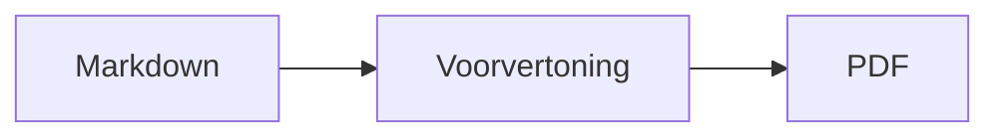
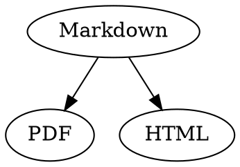

# Beknopte Markdown-naslag

Dit overzicht is een gewoon document: je kunt erin uitproberen wat je wilt, links in de bron of rechts in de voorvertoning.

## Tekst

| Resultaat | Syntaxis | Toetscombinatie |
|---|---|---|
| **Vet** | `**Vet**` | ⌘B |
| *Cursief* | `*Cursief*` | ⌘I |
| <ins>Onderstreept</ins> | `<ins>Onderstreept</ins>` | ⌘U |
| ~~Doorgehaald~~ | `~~Doorgehaald~~` | ⇧⌘X |
| <mark>Markering</mark> | `<mark>Markering</mark>` | |
| `Code` | `` `Code` `` | |
| x<sup>2</sup> | `x<sup>2</sup>` | |
| H<sub>2</sub>O | `H<sub>2</sub>O` | |
| [Link](https://example.com) | `[Link](https://example.com)` | ⌘K |

Onderstreept, markering, superscript en subscript zijn geen standaard-Markdown, maar HTML. Niet elke Markdown-viewer geeft ze weer.

Staat de cursor aan het eind van een woord, dan geldt de opmaak voor wat je daarna typt; binnen een woord wordt het hele woord opgemaakt.

## Kopteksten

```
# Koptekst 1
## Koptekst 2
### Koptekst 3
```

Toetscombinaties: ⌥⌘1 t/m ⌥⌘6, hoofdtekst met ⌥⌘0.

## Lijsten

- Opsomming met `-`
- Tweede punt
  - Ingesprongen met Tab in de voorvertoning

1. Genummerde lijst met `1.`
2. Tweede punt

- [ ] Open taak
- [x] Voltooide taak (klik erop in de voorvertoning om de status te wijzigen)

## Citaten en code

> Een citaat begint met `>`.

```rust
fn main() {
    println!("Codeblok met een taal");
}
```

De taal na de drie backticks zorgt voor syntaxiskleuren. ‘Opmaak › Codeblok’ biedt de gangbare talen aan en wijzigt ze ook voor een bestaand blok.

> [!TIP]
> Infokaders zijn er als Notitie, Tip, Belangrijk, Waarschuwing en Let op (‘Opmaak › Infokader’ maakt de alinea bij de cursor op).

## Tabellen

| Links | Midden | Rechts |
|:------|:---------:|-------:|
| a     | b         | c      |

In de voorvertoning gaat Tab naar de volgende cel en Return naar de cel eronder. Het menu ‘Tabel’ voegt rijen en kolommen in en lijnt de kolommen in de bron uit.

## Formules en diagrammen

Inline formule: $E = mc^2$

$$
\int_0^1 x^2 \, dx = \frac{1}{3}
$$



Een klik op een formule of diagram in de voorvertoning opent de editor, net als wanneer de cursor erop terechtkomt; Esc sluit de editor zonder wijzigingen. Formules kun je visueel of als LaTeX bewerken; bouwstenen voegen breuken, wortels, sommen en symbolen in, en Tab springt naar de volgende plaatshouder □. Voor stroom-, sequentie- en Gantt-diagrammen zijn er bouwstenen voor knooppunten, verbindingen, berichten en taken. Fouten in de code toont de editor meteen.

Formules kunnen ook in `math`-blokken of tussen `\(` en `\)` staan. Graphviz- en PlantUML-diagrammen staan in blokken met `dot` en `plantuml`:



```plantuml
Alice -> Bob : Hi
```

## Uitgebreide syntaxis

==Markering==, x^2^, H~2~O, ||spoiler|| en :rocket: komen uit Obsidian, Typora en GitHub. %%Opmerkingen%% staan alleen in de bron, en voetnoten kunnen ook direct in de tekst staan^[zoals deze].

Begrip

: Uitleg in een definitielijst

> [!tip]-
> Klik op ▸ om het kader uit te vouwen.

[[Notitie]] linkt naar een notitie in dezelfde map of daaronder, ![[Notitie]] sluit haar in. #Tags, verwijzingen als @naam en #12 in GitHub- en GitLab-projecten en citaten als [@doe2020] uit een BibTeX-bestand worden gemarkeerd; ⌘-klik volgt ze. ‘Weergave › Typografische leestekens’ gebruikt de aanhalingstekens, gedachtestreepjes en beletseltekens van de taal.

### Eigen anker {#anker}

<details>
<summary>HTML</summary>

HTML zoals in README’s op GitHub wordt weergegeven: gecentreerde alinea’s, afbeeldingen met formaat, <kbd>⌘</kbd> en uitklapbare secties zoals deze.

</details>

## Overig

Return op een lege regel in de voorvertoning voegt nog een lege regel in, Backspace verwijdert die weer. In de bron staan daarvoor twee extra lege regels; andere Markdown-programma's tonen ze als gewone alinea-afstand.

‘Voeg in › Inhoudsopgave’ maakt links naar alle kopteksten; staat de cursor in de inhoudsopgave, dan wordt die bijgewerkt. ⌘-klik op een item om naar de koptekst te springen.

Voetnoten verwijzen naar aantekeningen[^1]. Een scheidingslijn maak je met `---`:

---

[^1]: De aantekening staat aan het eind van het document.
