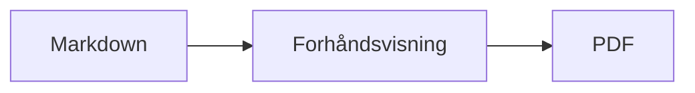
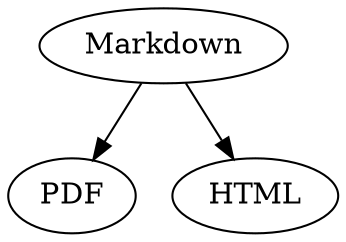

# Markdown-hurtigreferanse

Denne oversikten er et vanlig dokument: Du kan prøve ting i den, til venstre i kildeteksten eller til høyre i forhåndsvisningen.

## Tekst

| Resultat | Syntaks | Hurtigtast |
|---|---|---|
| **Halvfet** | `**Halvfet**` | ⌘B |
| *Kursiv* | `*Kursiv*` | ⌘I |
| <ins>Understreket</ins> | `<ins>Understreket</ins>` | ⌘U |
| ~~Gjennomstreket~~ | `~~Gjennomstreket~~` | ⇧⌘X |
| <mark>Uthevet</mark> | `<mark>Uthevet</mark>` | |
| `Kode` | `` `Kode` `` | |
| x<sup>2</sup> | `x<sup>2</sup>` | |
| H<sub>2</sub>O | `H<sub>2</sub>O` | |
| [Lenke](https://example.com) | `[Lenke](https://example.com)` | ⌘K |

Understreking, utheving, hevet og senket tekst er ikke standard Markdown, men HTML. Ikke alle Markdown-visere viser dem.

Står markøren på slutten av et ord, gjelder formateringen det du skriver etterpå; inne i et ord formaterer den hele ordet.

## Overskrifter

```
# Overskrift 1
## Overskrift 2
### Overskrift 3
```

Hurtigtaster: ⌥⌘1 til ⌥⌘6, brødtekst med ⌥⌘0.

## Lister

- Punktliste med `-`
- Andre punkt
  - Rykket inn med Tab i forhåndsvisningen

1. Nummerert liste med `1.`
2. Andre punkt

- [ ] Åpen oppgave
- [x] Fullført oppgave (klikk på den i forhåndsvisningen for å veksle)

## Sitater og kode

> Et sitat begynner med `>`.

```rust
fn main() {
    println!("Kodeblokk med språk");
}
```

Språket etter de tre backtick-tegnene gir syntaksfarger. «Format › Kodeblokk» tilbyr de vanlige språkene og endrer dem også for en eksisterende blokk.

> [!TIP]
> Infobokser finnes som Merk, Tips, Viktig, Advarsel og Forsiktig («Format › Infoboks» formaterer avsnittet ved markøren).

## Tabeller

| Venstre | Sentrert | Høyre |
|:------|:---------:|-------:|
| a     | b         | c      |

I forhåndsvisningen hopper Tab til neste celle og Return til cellen under. Menyen «Tabell» setter inn rader og kolonner og justerer kolonnene i kildeteksten.

## Formler og diagrammer

Formel i teksten: $E = mc^2$

$$
\int_0^1 x^2 \, dx = \frac{1}{3}
$$



Et klikk på en formel eller et diagram i forhåndsvisningen åpner editoren, og det samme skjer når markøren havner på den; Esc lukker den uten endringer. Formler kan redigeres visuelt eller som LaTeX; byggeklosser setter inn brøker, røtter, summer og symboler, og Tab hopper til neste plassholder □. Flytskjemaer, sekvens- og Gantt-diagrammer har byggeklosser for noder, forbindelser, meldinger og oppgaver. Editoren viser feil i koden med en gang.

Formler kan også stå i `math`-blokker eller mellom `\(` og `\)`. Graphviz- og PlantUML-diagrammer står i blokker med `dot` og `plantuml`:



```plantuml
Alice -> Bob : Hi
```

## Utvidet syntaks

==Utheving==, x^2^, H~2~O, ||spoiler|| og :rocket: kommer fra Obsidian, Typora og GitHub. %%Kommentarer%% står bare i kilden, og fotnoter kan også stå rett i teksten^[som denne].

Begrep

: Forklaring i en definisjonsliste

> [!tip]-
> Klikk på ▸ for å vise boksen.

[[Notat]] lenker til et notat i samme mappe eller under, ![[Notat]] bygger det inn. #Tagger, henvisninger som @navn og #12 i GitHub- og GitLab-prosjekter og sitater som [@doe2020] fra en BibTeX-fil utheves; ⌘-klikk følger dem. «Vis › Typografisk tegnsetting» bruker språkets anførselstegn, tankestreker og ellipser.

### Eget anker {#anker}

<details>
<summary>HTML</summary>

HTML som i README-filer på GitHub vises: midtstilte avsnitt, bilder med størrelse, <kbd>⌘</kbd> og sammenleggbare deler som denne.

</details>

## Annet

Return på en tom linje i forhåndsvisningen setter inn enda en tom linje, tilbaketasten fjerner den. I kildeteksten står det to ekstra tomme linjer for den; andre Markdown-programmer viser dem som vanlig avsnittsavstand.

«Sett inn › Innholdsfortegnelse» lenker til alle overskrifter; står markøren i fortegnelsen, blir den oppdatert. ⌘-klikk på en oppføring for å hoppe til overskriften.

Fotnoter viser til merknader[^1]. En skillestrek lages med `---`:

---

[^1]: Merknaden står på slutten av dokumentet.
