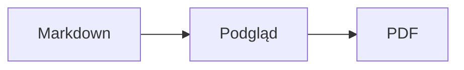
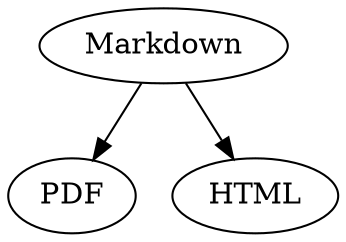

# Markdown – skrócony przewodnik

Ten przegląd to zwykły dokument: możesz w nim wszystko wypróbować, po lewej w tekście źródłowym albo po prawej w podglądzie.

## Tekst

| Wynik | Zapis | Skrót |
|---|---|---|
| **Pogrubienie** | `**Pogrubienie**` | ⌘B |
| *Kursywa* | `*Kursywa*` | ⌘I |
| <ins>Podkreślenie</ins> | `<ins>Podkreślenie</ins>` | ⌘U |
| ~~Przekreślenie~~ | `~~Przekreślenie~~` | ⇧⌘X |
| <mark>Wyróżnienie</mark> | `<mark>Wyróżnienie</mark>` | |
| `Kod` | `` `Kod` `` | |
| x<sup>2</sup> | `x<sup>2</sup>` | |
| H<sub>2</sub>O | `H<sub>2</sub>O` | |
| [Łącze](https://example.com) | `[Łącze](https://example.com)` | ⌘K |

Podkreślenie, wyróżnienie oraz indeks górny i dolny nie należą do standardu Markdown, lecz do HTML. Nie każda przeglądarka Markdown je wyświetla.

Gdy kursor stoi na końcu słowa, formatowanie dotyczy tego, co wpiszesz dalej; wewnątrz słowa formatuje całe słowo.

## Nagłówki

```
# Nagłówek 1
## Nagłówek 2
### Nagłówek 3
```

Skróty: od ⌥⌘1 do ⌥⌘6, tekst główny: ⌥⌘0.

## Listy

- Lista punktowana z `-`
- Drugi punkt
  - Wcięcie klawiszem Tab w podglądzie

1. Lista numerowana z `1.`
2. Drugi punkt

- [ ] Otwarte zadanie
- [x] Ukończone zadanie (kliknij w podglądzie, aby przełączyć)

## Cytaty i kod

> Cytat zaczyna się od `>`.

```rust
fn main() {
    println!("Blok kodu z językiem");
}
```

Język podany po trzech grawisach włącza kolorowanie składni. „Format › Blok kodu” oferuje popularne języki i zmienia je także w istniejącym bloku.

> [!TIP]
> Ramki informacyjne występują jako Notatka, Wskazówka, Ważne, Uwaga i Przestroga („Format › Ramka informacyjna” formatuje akapit, w którym stoi kursor).

## Tabele

| Do lewej | Do środka | Do prawej |
|:------|:---------:|-------:|
| a     | b         | c      |

W podglądzie Tab przechodzi do następnej komórki, a Return do komórki poniżej. Menu „Tabela” wstawia wiersze i kolumny oraz wyrównuje kolumny w tekście źródłowym.

## Wzory i diagramy

Wzór w tekście: $E = mc^2$

$$
\int_0^1 x^2 \, dx = \frac{1}{3}
$$



Kliknięcie wzoru lub diagramu w podglądzie otwiera edytor, podobnie jak przesunięcie na niego kursora; Esc zamyka go bez zmian. Wzory można edytować wizualnie lub jako LaTeX; gotowe elementy wstawiają ułamki, pierwiastki, sumy i symbole, a Tab przechodzi do następnego symbolu zastępczego □. Dla schematów blokowych, diagramów sekwencji i wykresów Gantta dostępne są gotowe elementy dla węzłów, połączeń, wiadomości i zadań. Błędy w kodzie edytor pokazuje od razu.

Wzory mogą też stać w blokach `math` albo między `\(` i `\)`. Diagramy Graphviz i PlantUML umieszcza się w blokach `dot` i `plantuml`:



```plantuml
Alice -> Bob : Hi
```

## Rozszerzona składnia

==Wyróżnienie==, x^2^, H~2~O, ||spoiler|| i :rocket: pochodzą z Obsidiana, Typory i GitHuba. %%Komentarze%% zostają tylko w źródle, a przypisy mogą stać też bezpośrednio w tekście^[jak ten].

Pojęcie

: Wyjaśnienie na liście definicji

> [!tip]-
> Kliknij ▸, aby rozwinąć ramkę.

[[Notatka]] łączy z notatką w tym samym folderze lub niżej, ![[Notatka]] ją osadza. #Tagi, odwołania takie jak @nazwa i #12 w projektach GitHub i GitLab oraz cytaty takie jak [@doe2020] z pliku BibTeX są wyróżniane; ⌘-kliknięcie przechodzi do nich. „Widok › Interpunkcja typograficzna” stosuje cudzysłowy, myślniki i wielokropki danego języka.

### Własna kotwica {#kotwica}

<details>
<summary>HTML</summary>

HTML jak w plikach README na GitHubie jest wyświetlany: wyśrodkowane akapity, obrazy z rozmiarem, <kbd>⌘</kbd> i rozwijane sekcje takie jak ta.

</details>

## Inne

Return w pustym wierszu podglądu wstawia kolejny pusty wiersz, a Backspace go usuwa. W tekście źródłowym odpowiadają im dwa dodatkowe puste wiersze; inne programy do Markdown pokazują je jako zwykły odstęp między akapitami.

„Wstaw › Spis treści” tworzy łącza do wszystkich nagłówków; gdy kursor stoi w spisie treści, spis zostaje zaktualizowany. ⌘-kliknięcie wpisu przenosi do nagłówka.

Przypisy odsyłają do objaśnień[^1]. Separator tworzy się za pomocą `---`:

---

[^1]: Objaśnienie znajduje się na końcu dokumentu.
