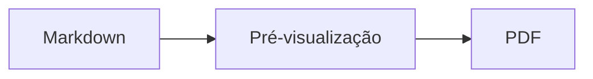
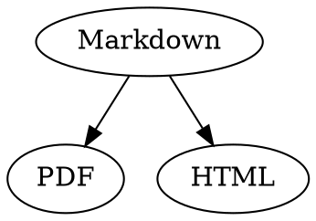

# Referência Rápida de Markdown

Esta visão geral é um documento comum: experimente à vontade nele, no código-fonte à esquerda ou na pré-visualização à direita.

## Texto

| Resultado | Sintaxe | Atalho |
|---|---|---|
| **Negrito** | `**Negrito**` | ⌘B |
| *Itálico* | `*Itálico*` | ⌘I |
| <ins>Sublinhado</ins> | `<ins>Sublinhado</ins>` | ⌘U |
| ~~Tachado~~ | `~~Tachado~~` | ⇧⌘X |
| <mark>Destaque</mark> | `<mark>Destaque</mark>` | |
| `Código` | `` `Código` `` | |
| x<sup>2</sup> | `x<sup>2</sup>` | |
| H<sub>2</sub>O | `H<sub>2</sub>O` | |
| [Link](https://example.com) | `[Link](https://example.com)` | ⌘K |

Sublinhado, destaque, sobrescrito e subscrito não são Markdown padrão, e sim HTML. Nem todo visualizador de Markdown os exibe.

Com o cursor no fim de uma palavra, a formatação vale para o que você digitar em seguida; dentro de uma palavra, ela formata a palavra inteira.

## Títulos

```
# Título 1
## Título 2
### Título 3
```

Atalhos: ⌥⌘1 a ⌥⌘6, corpo de texto com ⌥⌘0.

## Listas

- Lista com marcadores com `-`
- Segundo item
  - Recuado com Tab na pré-visualização

1. Lista numerada com `1.`
2. Segundo item

- [ ] Tarefa pendente
- [x] Tarefa concluída (clique nela na pré-visualização para alternar)

## Citações e código

> Uma citação começa com `>`.

```rust
fn main() {
    println!("Bloco de código com linguagem");
}
```

A linguagem depois das três crases ativa as cores de sintaxe. “Formatar › Bloco de Código” oferece as linguagens mais comuns e também as altera em um bloco existente.

> [!TIP]
> As caixas de informação existem como Nota, Dica, Importante, Aviso e Cuidado (“Formatar › Caixa de Informação” formata o parágrafo onde está o cursor).

## Tabelas

| Esquerda | Centro | Direita |
|:------|:---------:|-------:|
| a     | b         | c      |

Na pré-visualização, Tab vai para a próxima célula e Return para a célula abaixo. O menu “Tabela” insere linhas e colunas e alinha as colunas no código-fonte.

## Fórmulas e diagramas

Fórmula em linha: $E = mc^2$

$$
\int_0^1 x^2 \, dx = \frac{1}{3}
$$



Clicar em uma fórmula ou em um diagrama na pré-visualização abre o editor, assim como posicionar o cursor sobre ele; Esc o fecha sem alterações. As fórmulas podem ser editadas visualmente ou como LaTeX; os blocos de construção inserem frações, raízes, somatórios e símbolos, e Tab salta para o próximo marcador de posição □. Para fluxogramas, diagramas de sequência e de Gantt há blocos de construção para nós, conexões, mensagens e tarefas. O editor mostra os erros no código imediatamente.

Fórmulas também podem ficar em blocos `math` ou entre `\(` e `\)`. Diagramas Graphviz e PlantUML ficam em blocos `dot` e `plantuml`:



```plantuml
Alice -> Bob : Hi
```

## Sintaxe estendida

==Destaque==, x^2^, H~2~O, ||spoiler|| e :rocket: vêm do Obsidian, do Typora e do GitHub. %%Comentários%% ficam só no código-fonte, e notas de rodapé também podem ficar direto no texto^[como esta].

Termo

: Explicação em uma lista de definições

> [!tip]-
> Clique em ▸ para expandir o quadro.

[[Nota]] cria um link para uma nota na mesma pasta ou abaixo, ![[Nota]] a incorpora. #Tags, referências como @nome e #12 em projetos do GitHub e do GitLab e citações como [@doe2020] de um arquivo BibTeX são destacadas; ⌘-clique segue cada uma. “Visualizar › Pontuação tipográfica” usa as aspas, travessões e reticências do idioma.

### Âncora própria {#ancora}

<details>
<summary>HTML</summary>

HTML como o dos README do GitHub é exibido: parágrafos centralizados, imagens com tamanho, <kbd>⌘</kbd> e seções recolhíveis como esta.

</details>

## Outros

Return em uma linha vazia da pré-visualização insere outra linha vazia, e Delete a remove. No código-fonte, isso corresponde a duas linhas vazias extras; outros programas de Markdown as exibem como espaçamento normal entre parágrafos.

“Inserir › Índice” cria links para todos os títulos; com o cursor dentro do índice, ele é atualizado. ⌘-clique em uma entrada para saltar até o título.

As notas de rodapé remetem a anotações[^1]. Um separador é criado com `---`:

---

[^1]: A anotação fica no final do documento.
