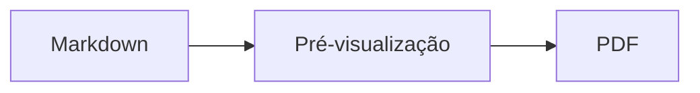
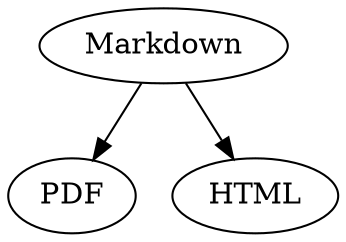

# Referência rápida de Markdown

Esta vista geral é um documento normal: pode fazer experiências nele, no código-fonte à esquerda ou na pré-visualização à direita.

## Texto

| Resultado | Sintaxe | Atalho |
|---|---|---|
| **Negrito** | `**Negrito**` | ⌘B |
| *Itálico* | `*Itálico*` | ⌘I |
| <ins>Sublinhado</ins> | `<ins>Sublinhado</ins>` | ⌘U |
| ~~Riscado~~ | `~~Riscado~~` | ⇧⌘X |
| <mark>Destaque</mark> | `<mark>Destaque</mark>` | |
| `Código` | `` `Código` `` | |
| x<sup>2</sup> | `x<sup>2</sup>` | |
| H<sub>2</sub>O | `H<sub>2</sub>O` | |
| [Hiperligação](https://example.com) | `[Hiperligação](https://example.com)` | ⌘K |

Sublinhado, destaque, expoente e índice não são Markdown padrão, mas sim HTML. Nem todos os visualizadores de Markdown os apresentam.

Com o cursor no fim de uma palavra, a formatação aplica-se ao que escrever a seguir; dentro de uma palavra, formata a palavra inteira.

## Cabeçalhos

```
# Cabeçalho 1
## Cabeçalho 2
### Cabeçalho 3
```

Atalhos: ⌥⌘1 a ⌥⌘6, corpo de texto com ⌥⌘0.

## Listas

- Lista com marcas com `-`
- Segundo item
  - Indentado com Tab na pré-visualização

1. Lista numerada com `1.`
2. Segundo item

- [ ] Tarefa por fazer
- [x] Tarefa concluída (clique nela na pré-visualização para alternar)

## Citações e código

> Uma citação começa com `>`.

```rust
fn main() {
    println!("Bloco de código com linguagem");
}
```

A linguagem a seguir aos três acentos graves ativa as cores de sintaxe. “Formatação › Bloco de código” propõe as linguagens mais comuns e também as altera num bloco existente.

> [!TIP]
> As caixas de informação existem como Nota, Dica, Importante, Aviso e Cuidado (“Formatação › Caixa de informação” formata o parágrafo onde está o cursor).

## Tabelas

| Esquerda | Centro | Direita |
|:------|:---------:|-------:|
| a     | b         | c      |

Na pré-visualização, Tab passa para a célula seguinte e Return para a célula abaixo. O menu “Tabela” insere linhas e colunas e alinha as colunas no código-fonte.

## Fórmulas e diagramas

Fórmula em linha: $E = mc^2$

$$
\int_0^1 x^2 \, dx = \frac{1}{3}
$$



Clicar numa fórmula ou num diagrama na pré-visualização abre o editor, tal como colocar o cursor sobre ele; Esc fecha-o sem alterações. As fórmulas podem ser editadas visualmente ou como LaTeX; os blocos de construção inserem frações, raízes, somatórios e símbolos, e Tab salta para o marcador de posição □ seguinte. Para fluxogramas, diagramas de sequência e de Gantt existem blocos de construção para nós, ligações, mensagens e tarefas. O editor mostra de imediato os erros no código.

As fórmulas também podem ficar em blocos `math` ou entre `\(` e `\)`. Os diagramas Graphviz e PlantUML ficam em blocos `dot` e `plantuml`:



```plantuml
Alice -> Bob : Hi
```

## Sintaxe alargada

==Realce==, x^2^, H~2~O, ||spoiler|| e :rocket: vêm do Obsidian, do Typora e do GitHub. Os %%comentários%% ficam apenas no código-fonte, e as notas de rodapé também podem ficar diretamente no texto^[como esta].

Termo

: Explicação numa lista de definições

> [!tip]-
> Clique em ▸ para expandir a caixa.

[[Nota]] liga a uma nota na mesma pasta ou abaixo, ![[Nota]] incorpora-a. As #etiquetas, as referências como @nome e #12 em projetos do GitHub e do GitLab e as citações como [@doe2020] de um ficheiro BibTeX são realçadas; ⌘-clique segue-as. «Visualização › Pontuação tipográfica» usa as aspas, os travessões e as reticências da língua.

### Âncora própria {#ancora}

<details>
<summary>HTML</summary>

O HTML dos README do GitHub é apresentado: parágrafos centrados, imagens com tamanho, <kbd>⌘</kbd> e secções recolhíveis como esta.

</details>

## Outros

Return numa linha vazia da pré-visualização insere outra linha vazia, e Delete remove-a. No código-fonte, isso corresponde a duas linhas vazias adicionais; outros programas de Markdown mostram-nas como espaçamento normal entre parágrafos.

“Inserir › Índice” cria hiperligações para todos os cabeçalhos; com o cursor dentro do índice, este é atualizado. ⌘-clique numa entrada para saltar para o cabeçalho.

As notas de rodapé remetem para anotações[^1]. Uma linha divisória cria-se com `---`:

---

[^1]: A anotação encontra-se no fim do documento.
