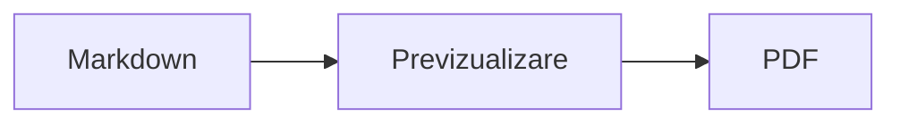
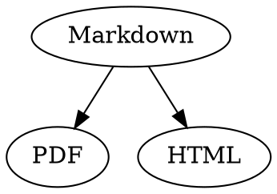

# Referință rapidă Markdown

Această prezentare generală este un document obișnuit: puteți încerca lucruri în el, în sursa din stânga sau în previzualizarea din dreapta.

## Text

| Rezultat | Sintaxă | Scurtătură |
|---|---|---|
| **Aldin** | `**Aldin**` | ⌘B |
| *Cursiv* | `*Cursiv*` | ⌘I |
| <ins>Subliniat</ins> | `<ins>Subliniat</ins>` | ⌘U |
| ~~Tăiat cu o linie~~ | `~~Tăiat cu o linie~~` | ⇧⌘X |
| <mark>Evidențiere</mark> | `<mark>Evidențiere</mark>` | |
| `Cod` | `` `Cod` `` | |
| x<sup>2</sup> | `x<sup>2</sup>` | |
| H<sub>2</sub>O | `H<sub>2</sub>O` | |
| [Link](https://example.com) | `[Link](https://example.com)` | ⌘K |

Sublinierea, evidențierea, exponentul și indicele nu fac parte din Markdown standard, ci sunt HTML. Nu orice vizualizator Markdown le afișează.

Când cursorul se află la sfârșitul unui cuvânt, formatarea se aplică textului pe care îl tastați în continuare; în interiorul unui cuvânt, formatează întregul cuvânt.

## Titluri

```
# Titlu 1
## Titlu 2
### Titlu 3
```

Scurtături: ⌥⌘1 până la ⌥⌘6, corp text cu ⌥⌘0.

## Liste

- Listă cu marcatori cu `-`
- Al doilea element
  - Indentat cu Tab în previzualizare

1. Listă numerotată cu `1.`
2. Al doilea element

- [ ] Sarcină deschisă
- [x] Sarcină finalizată (faceți clic pe ea în previzualizare pentru a o comuta)

## Citate și cod

> Un citat începe cu `>`.

```rust
fn main() {
    println!("Bloc de cod cu limbaj");
}
```

Limbajul de după cele trei accente grave adaugă culori de sintaxă. „Format › Bloc de cod” oferă limbajele uzuale și le schimbă și pentru un bloc existent.

> [!TIP]
> Casetele informative există ca Notă, Sfat, Important, Avertisment și Atenție („Format › Casetă informativă” formatează paragraful de la cursor).

## Tabele

| Stânga | Centrat | Dreapta |
|:------|:---------:|-------:|
| a     | b         | c      |

În previzualizare, Tab trece la celula următoare, iar Return la celula de dedesubt. Meniul „Tabel” inserează rânduri și coloane și aliniază coloanele în sursă.

## Formule și diagrame

Formulă în linie: $E = mc^2$

$$
\int_0^1 x^2 \, dx = \frac{1}{3}
$$



Un clic pe o formulă sau pe o diagramă din previzualizare deschide editorul, la fel ca mutarea cursorului pe ea; Esc îl închide fără modificări. Formulele pot fi editate vizual sau ca LaTeX; blocurile inserează fracții, radicali, sume și simboluri, iar Tab sare la următorul substituent □. Pentru diagramele de flux, de secvență și Gantt există blocuri pentru noduri, conexiuni, mesaje și sarcini. Editorul afișează imediat erorile din cod.

Formulele pot sta și în blocuri `math` sau între `\(` și `\)`. Diagramele Graphviz și PlantUML stau în blocuri `dot` și `plantuml`:



```plantuml
Alice -> Bob : Hi
```

## Sintaxă extinsă

==Evidențiere==, x^2^, H~2~O, ||spoiler|| și :rocket: vin din Obsidian, Typora și GitHub. %%Comentariile%% rămân doar în sursă, iar notele de subsol pot sta și direct în text^[ca aceasta].

Termen

: Explicație într-o listă de definiții

> [!tip]-
> Faceți clic pe ▸ pentru a extinde caseta.

[[Notă]] trimite la o notă din același dosar sau de mai jos, ![[Notă]] o încorporează. #Etichetele, referințele precum @nume și #12 din proiectele GitHub și GitLab și citările precum [@doe2020] dintr-un fișier BibTeX sunt evidențiate; ⌘-clic le urmează. „Vizualizare › Punctuație tipografică” folosește ghilimelele, liniile de pauză și punctele de suspensie ale limbii.

### Ancoră proprie {#ancora}

<details>
<summary>HTML</summary>

HTML-ul ca în fișierele README de pe GitHub este afișat: paragrafe centrate, imagini cu dimensiune, <kbd>⌘</kbd> și secțiuni extensibile ca aceasta.

</details>

## Altele

Return pe un rând gol din previzualizare inserează încă un rând gol, iar Delete îl elimină. În sursă, acestea apar ca două rânduri goale suplimentare; alte programe Markdown le afișează ca spațiere normală între paragrafe.

„Inserare › Tablă de materii” creează linkuri către toate titlurile; dacă cursorul se află în tabla de materii, aceasta este actualizată. ⌘-clic pe o intrare duce la titlul respectiv.

Notele de subsol trimit la adnotări[^1]. Un separator se creează cu `---`:

---

[^1]: Adnotarea se află la sfârșitul documentului.
