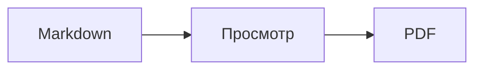
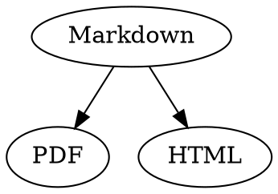

# Краткий справочник по Markdown

Этот обзор — обычный документ: в нем можно экспериментировать, слева в исходном тексте или справа в окне просмотра.

## Текст

| Результат | Синтаксис | Сочетание клавиш |
|---|---|---|
| **Жирный** | `**Жирный**` | ⌘B |
| *Курсив* | `*Курсив*` | ⌘I |
| <ins>Подчеркнутый</ins> | `<ins>Подчеркнутый</ins>` | ⌘U |
| ~~Зачеркнутый~~ | `~~Зачеркнутый~~` | ⇧⌘X |
| <mark>Выделение</mark> | `<mark>Выделение</mark>` | |
| `Код` | `` `Код` `` | |
| x<sup>2</sup> | `x<sup>2</sup>` | |
| H<sub>2</sub>O | `H<sub>2</sub>O` | |
| [Ссылка](https://example.com) | `[Ссылка](https://example.com)` | ⌘K |

Подчеркивание, выделение, надстрочный и подстрочный текст — это не стандартный Markdown, а HTML. Не каждая программа для просмотра Markdown их показывает.

Если курсор стоит в конце слова, форматирование применяется к тому, что вы напечатаете дальше; внутри слова оно форматирует все слово.

## Заголовки

```
# Заголовок 1
## Заголовок 2
### Заголовок 3
```

Сочетания клавиш: от ⌥⌘1 до ⌥⌘6, основной текст — ⌥⌘0.

## Списки

- Маркированный список с `-`
- Второй пункт
  - Отступ клавишей Tab в окне просмотра

1. Нумерованный список с `1.`
2. Второй пункт

- [ ] Открытая задача
- [x] Выполненная задача (нажмите на нее в окне просмотра, чтобы переключить)

## Цитаты и код

> Цитата начинается с `>`.

```rust
fn main() {
    println!("Блок кода с указанием языка");
}
```

Язык, указанный после трех обратных апострофов, включает подсветку синтаксиса. «Формат › Блок кода» предлагает распространенные языки и меняет язык и у существующего блока.

> [!TIP]
> Выноски бывают пяти видов: «Примечание», «Совет», «Важно», «Внимание» и «Осторожно» («Формат › Выноска» оформляет абзац, в котором стоит курсор).

## Таблицы

| Слева | По центру | Справа |
|:------|:---------:|-------:|
| a     | b         | c      |

В окне просмотра Tab переходит в следующую ячейку, а Return — в ячейку ниже. Меню «Таблица» вставляет строки и столбцы и выравнивает столбцы в исходном тексте.

## Формулы и диаграммы

Формула в строке: $E = mc^2$

$$
\int_0^1 x^2 \, dx = \frac{1}{3}
$$



Нажатие на формулу или диаграмму в окне просмотра открывает редактор, как и перемещение курсора на нее; Esc закрывает его без изменений. Формулы можно редактировать визуально или в виде LaTeX; готовые блоки вставляют дроби, корни, суммы и символы, а Tab переходит к следующему заполнителю □. Для блок-схем, диаграмм последовательности и диаграмм Ганта есть готовые блоки для узлов, связей, сообщений и задач. Ошибки в коде редактор показывает сразу.

Формулы также можно записывать в блоках `math` или между `\(` и `\)`. Диаграммы Graphviz и PlantUML записываются в блоках `dot` и `plantuml`:



```plantuml
Alice -> Bob : Hi
```

## Расширенный синтаксис

==Выделение==, x^2^, H~2~O, ||спойлер|| и :rocket: пришли из Obsidian, Typora и GitHub. %%Комментарии%% видны только в исходном тексте, а сноски можно писать прямо в тексте^[вот так].

Термин

: Пояснение в списке определений

> [!tip]-
> Нажатие на ▸ разворачивает блок.

[[Заметка]] ссылается на заметку в той же папке или во вложенной, ![[Заметка]] встраивает ее. #Теги, упоминания вроде @name и #12 в проектах GitHub и GitLab, а также цитаты вроде [@doe2020] из файла BibTeX выделяются; нажатие с ⌘ открывает их. «Вид › Типографские знаки препинания» расставляет кавычки, тире и многоточия, принятые в языке.

### Собственный якорь {#yakor}

<details>
<summary>HTML</summary>

HTML, как в README на GitHub, тоже отображается: абзацы по центру, изображения заданного размера, <kbd>⌘</kbd> и раскрывающиеся разделы, как этот.

</details>

## Прочее

Return на пустой строке в окне просмотра добавляет еще одну пустую строку, клавиша Delete (⌫) удаляет ее. В исходном тексте для этого стоят две дополнительные пустые строки; другие программы для Markdown показывают их как обычный отступ между абзацами.

«Вставка › Оглавление» создает ссылки на все заголовки; если курсор стоит в оглавлении, оно обновляется. Нажатие с ⌘ на пункт оглавления переходит к заголовку.

Сноски ведут к примечаниям[^1]. Горизонтальная линия создается с помощью `---`:

---

[^1]: Примечание находится в конце документа.
