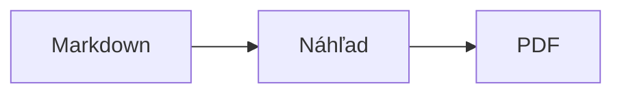
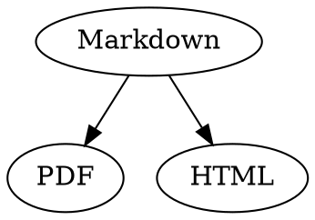

# Markdown – stručný prehľad

Tento prehľad je bežný dokument: môžete si v ňom všetko vyskúšať, vľavo v zdrojovom texte alebo vpravo v náhľade.

## Text

| Výsledok | Zápis | Skratka |
|---|---|---|
| **Tučné** | `**Tučné**` | ⌘B |
| *Kurzíva* | `*Kurzíva*` | ⌘I |
| <ins>Podčiarknuté</ins> | `<ins>Podčiarknuté</ins>` | ⌘U |
| ~~Preškrtnuté~~ | `~~Preškrtnuté~~` | ⇧⌘X |
| <mark>Zvýraznenie</mark> | `<mark>Zvýraznenie</mark>` | |
| `Kód` | `` `Kód` `` | |
| x<sup>2</sup> | `x<sup>2</sup>` | |
| H<sub>2</sub>O | `H<sub>2</sub>O` | |
| [Odkaz](https://example.com) | `[Odkaz](https://example.com)` | ⌘K |

Podčiarknutie, zvýraznenie, horný a dolný index nie sú štandardný Markdown, ale HTML. Nie každý prehliadač Markdownu ich zobrazí.

Keď je kurzor na konci slova, formátovanie platí pre to, čo napíšete ďalej; vnútri slova sa naformátuje celé slovo.

## Nadpisy

```
# Nadpis 1
## Nadpis 2
### Nadpis 3
```

Skratky: ⌥⌘1 až ⌥⌘6, základný text pomocou ⌥⌘0.

## Zoznamy

- Zoznam s odrážkami pomocou `-`
- Druhá položka
  - Odsadené klávesom Tab v náhľade

1. Číslovaný zoznam pomocou `1.`
2. Druhá položka

- [ ] Otvorená úloha
- [x] Dokončená úloha (prepnete kliknutím v náhľade)

## Citácie a kód

> Citácia sa začína znakom `>`.

```rust
fn main() {
    println!("Blok kódu s jazykom");
}
```

Jazyk uvedený za tromi opačnými apostrofmi zapne farebné zvýrazňovanie syntaxe. „Formát › Blok kódu“ ponúka bežné jazyky a zmení ich aj pre existujúci blok.

> [!TIP]
> Informačné rámčeky sú k dispozícii ako Poznámka, Tip, Dôležité, Upozornenie a Pozor („Formát › Informačný rámček“ naformátuje odstavec pri kurzore).

## Tabuľky

| Vľavo | Na stred | Vpravo |
|:------|:---------:|-------:|
| a     | b         | c      |

V náhľade presunie Tab kurzor do ďalšej bunky a Return do bunky pod ňou. Menu „Tabuľka“ vkladá riadky a stĺpce a zarovná stĺpce v zdrojovom texte.

## Vzorce a diagramy

Vzorec v texte: $E = mc^2$

$$
\int_0^1 x^2 \, dx = \frac{1}{3}
$$



Kliknutím na vzorec alebo diagram v náhľade sa otvorí editor, rovnako ako keď naň presuniete kurzor; Esc ho zatvorí bez zmien. Vzorce sa dajú upravovať vizuálne alebo ako LaTeX; stavebné bloky vkladajú zlomky, odmocniny, súčty a symboly a Tab preskočí na ďalší zástupný symbol □. Pre vývojové, sekvenčné a Ganttove diagramy sú k dispozícii stavebné bloky pre uzly, spojenia, správy a úlohy. Chyby v kóde editor zobrazí okamžite.

Vzorce môžu byť aj v blokoch `math` alebo medzi `\(` a `\)`. Diagramy Graphviz a PlantUML patria do blokov `dot` a `plantuml`:



```plantuml
Alice -> Bob : Hi
```

## Rozšírená syntax

==Zvýraznenie==, x^2^, H~2~O, ||spoiler|| a :rocket: pochádzajú z Obsidianu, Typory a GitHubu. %%Komentáre%% zostávajú len v zdroji a poznámky pod čiarou môžu byť aj priamo v texte^[ako táto].

Pojem

: Vysvetlenie v zozname definícií

> [!tip]-
> Kliknutím na ▸ rámček rozbalíte.

[[Poznámka]] odkazuje na poznámku v rovnakom priečinku alebo pod ním, ![[Poznámka]] ju vloží. #Štítky, odkazy ako @meno a #12 v projektoch GitHub a GitLab a citácie ako [@doe2020] zo súboru BibTeX sa zvýraznia; ⌘-kliknutie na ne prejde. „Zobraziť › Typografická interpunkcia“ nastaví úvodzovky, pomlčky a výpustky daného jazyka.

### Vlastná kotva {#kotva}

<details>
<summary>HTML</summary>

HTML ako v README na GitHube sa zobrazí: zarovnané odseky, obrázky s veľkosťou, <kbd>⌘</kbd> a rozbaľovacie sekcie ako táto.

</details>

## Ostatné

Return na prázdnom riadku náhľadu vloží ďalší prázdny riadok, Backspace ho odstráni. V zdrojovom texte sú na to dva prázdne riadky navyše; iné programy pre Markdown ich zobrazia ako bežnú medzeru medzi odstavcami.

„Vložiť › Obsah“ vytvorí odkazy na všetky nadpisy; keď je kurzor v obsahu, obsah sa aktualizuje. ⌘-kliknutím na položku prejdete na nadpis.

Poznámky pod čiarou odkazujú na vysvetlivky[^1]. Oddeľovač vytvoríte pomocou `---`:

---

[^1]: Vysvetlivka je na konci dokumentu.
