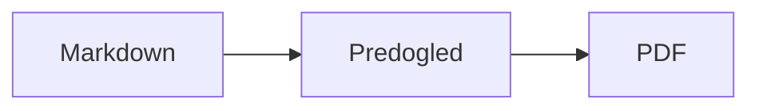
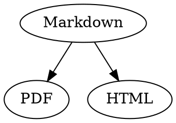

# Markdown – hitri priročnik

Ta pregled je običajen dokument: v njem lahko vse preizkusite, levo v izvornem besedilu ali desno v predogledu.

## Besedilo

| Rezultat | Zapis | Bližnjica |
|---|---|---|
| **Krepko** | `**Krepko**` | ⌘B |
| *Ležeče* | `*Ležeče*` | ⌘I |
| <ins>Podčrtano</ins> | `<ins>Podčrtano</ins>` | ⌘U |
| ~~Prečrtano~~ | `~~Prečrtano~~` | ⇧⌘X |
| <mark>Označeno</mark> | `<mark>Označeno</mark>` | |
| `Koda` | `` `Koda` `` | |
| x<sup>2</sup> | `x<sup>2</sup>` | |
| H<sub>2</sub>O | `H<sub>2</sub>O` | |
| [Povezava](https://example.com) | `[Povezava](https://example.com)` | ⌘K |

Podčrtano, označeno, nadpisano in podpisano besedilo ni standardni Markdown, temveč HTML. Ne prikaže ga vsak pregledovalnik za Markdown.

Ko je kazalka na koncu besede, velja oblikovanje za to, kar boste natipkali v nadaljevanju; znotraj besede oblikuje celotno besedo.

## Naslovi

```
# Naslov 1
## Naslov 2
### Naslov 3
```

Bližnjice: ⌥⌘1 do ⌥⌘6, navadno besedilo z ⌥⌘0.

## Seznami

- Seznam s pikami z `-`
- Druga točka
  - Zamaknjeno s tipko Tab v predogledu

1. Seznam s številkami z `1.`
2. Druga točka

- [ ] Odprto opravilo
- [x] Dokončano opravilo (za preklop kliknite nanj v predogledu)

## Citati in koda

> Citat se začne z `>`.

```rust
fn main() {
    println!("Blok kode z jezikom");
}
```

Jezik za tremi krativci omogoči barvanje sintakse. »Oblikovanje › Blok kode« ponuja pogoste jezike in jih spremeni tudi za obstoječi blok.

> [!TIP]
> Informativni okvirji so na voljo kot Opomba, Nasvet, Pomembno, Opozorilo in Previdno (»Oblikovanje › Informativni okvir« oblikuje odstavek pri kazalki).

## Tabele

| Levo | Na sredino | Desno |
|:------|:---------:|-------:|
| a     | b         | c      |

V predogledu Tab skoči v naslednjo celico, Return pa v celico spodaj. Meni »Tabela« vstavlja vrstice in stolpce ter poravna stolpce v izvornem besedilu.

## Formule in diagrami

Formula v besedilu: $E = mc^2$

$$
\int_0^1 x^2 \, dx = \frac{1}{3}
$$



Klik na formulo ali diagram v predogledu odpre urejevalnik, prav tako premik kazalke nanj; Esc ga zapre brez sprememb. Formule lahko urejate vizualno ali kot LaTeX; gradniki vstavljajo ulomke, korene, vsote in simbole, Tab pa skoči na naslednje nadomestno mesto □. Za diagrame poteka, diagrame zaporedja in Ganttove diagrame so na voljo gradniki za vozlišča, povezave, sporočila in opravila. Napake v kodi urejevalnik prikaže takoj.

Formule so lahko tudi v blokih `math` ali med `\(` in `\)`. Diagrami Graphviz in PlantUML sodijo v bloke `dot` in `plantuml`:



```plantuml
Alice -> Bob : Hi
```

## Razširjena skladnja

==Poudarek==, x^2^, H~2~O, ||spoiler|| in :rocket: prihajajo iz Obsidiana, Typore in GitHuba. %%Komentarji%% ostanejo samo v izvorni kodi, opombe pa so lahko tudi neposredno v besedilu^[kot ta].

Pojem

: Razlaga na seznamu definicij

> [!tip]-
> Kliknite ▸, da razširite okvir.

[[Zapisek]] povezuje na zapisek v isti mapi ali nižje, ![[Zapisek]] ga vdela. #Oznake, sklici, kot sta @ime in #12 v projektih GitHub in GitLab, ter navedki, kot je [@doe2020] iz datoteke BibTeX, so poudarjeni; ⌘-klik jim sledi. »Prikaz › Tipografska ločila« uporabi narekovaje, pomišljaje in tropičja jezika.

### Lastno sidro {#sidro}

<details>
<summary>HTML</summary>

HTML, kot je v datotekah README na GitHubu, se prikaže: poravnani odstavki, slike z velikostjo, <kbd>⌘</kbd> in razširljivi razdelki, kot je ta.

</details>

## Drugo

Return v prazni vrstici predogleda vstavi še eno prazno vrstico, Backspace jo odstrani. V izvornem besedilu sta za to dve dodatni prazni vrstici; drugi programi za Markdown ju prikažejo kot običajen razmik med odstavki.

»Vstavi › Kazalo vsebine« poveže vse naslove; če je kazalka v kazalu, se kazalo posodobi. ⌘-klik na vnos skoči na naslov.

Sprotne opombe se sklicujejo na pojasnila[^1]. Ločilo ustvarite z `---`:

---

[^1]: Pojasnilo je na koncu dokumenta.
