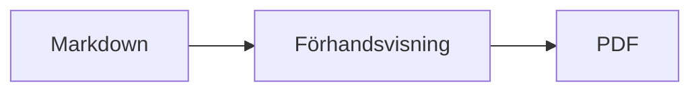
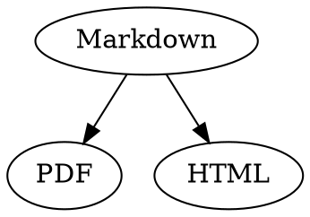

# Markdown-snabbreferens

Den här översikten är ett vanligt dokument: du kan prova saker i den, till vänster i källtexten eller till höger i förhandsvisningen.

## Text

| Resultat | Syntax | Kortkommando |
|---|---|---|
| **Fet** | `**Fet**` | ⌘B |
| *Kursiv* | `*Kursiv*` | ⌘I |
| <ins>Understruken</ins> | `<ins>Understruken</ins>` | ⌘U |
| ~~Genomstruken~~ | `~~Genomstruken~~` | ⇧⌘X |
| <mark>Markerad</mark> | `<mark>Markerad</mark>` | |
| `Kod` | `` `Kod` `` | |
| x<sup>2</sup> | `x<sup>2</sup>` | |
| H<sub>2</sub>O | `H<sub>2</sub>O` | |
| [Länk](https://example.com) | `[Länk](https://example.com)` | ⌘K |

Understrykning, markering, upphöjd och nedsänkt text är inte standard-Markdown utan HTML. Inte alla Markdown-visare visar dem.

Står markören i slutet av ett ord gäller formateringen det du skriver därefter; inuti ett ord formateras hela ordet.

## Rubriker

```
# Rubrik 1
## Rubrik 2
### Rubrik 3
```

Kortkommandon: ⌥⌘1 till ⌥⌘6, brödtext med ⌥⌘0.

## Listor

- Lista i punktformat med `-`
- Andra punkten
  - Indragen med Tab i förhandsvisningen

1. Numrerad lista med `1.`
2. Andra punkten

- [ ] Öppen uppgift
- [x] Klar uppgift (klicka på den i förhandsvisningen för att växla)

## Citat och kod

> Ett citat börjar med `>`.

```rust
fn main() {
    println!("Kodblock med språk");
}
```

Språket efter de tre backtick-tecknen ger syntaxfärger. ”Format › Kodblock” erbjuder de vanligaste språken och ändrar dem även för ett befintligt block.

> [!TIP]
> Inforutor finns som Obs, Tips, Viktigt, Varning och Försiktighet (”Format › Inforuta” formaterar stycket vid markören).

## Tabeller

| Vänster | Centrerad | Höger |
|:------|:---------:|-------:|
| a     | b         | c      |

I förhandsvisningen hoppar Tab till nästa cell och Return till cellen nedanför. Menyn ”Tabell” infogar rader och kolumner och justerar kolumnerna i källtexten.

## Formler och diagram

Formel i texten: $E = mc^2$

$$
\int_0^1 x^2 \, dx = \frac{1}{3}
$$



Ett klick på en formel eller ett diagram i förhandsvisningen öppnar redigeraren, liksom när markören hamnar på den; Esc stänger den utan ändringar. Formler kan redigeras visuellt eller som LaTeX; byggblock infogar bråk, rötter, summor och symboler, och Tab hoppar till nästa platshållare □. Flödesscheman, sekvensdiagram och Gantt-scheman har byggblock för noder, kopplingar, meddelanden och uppgifter. Redigeraren visar fel i koden direkt.

Formler kan också stå i `math`-block eller mellan `\(` och `\)`. Graphviz- och PlantUML-diagram står i block med `dot` och `plantuml`:



```plantuml
Alice -> Bob : Hi
```

## Utökad syntax

==Markering==, x^2^, H~2~O, ||spoiler|| och :rocket: kommer från Obsidian, Typora och GitHub. %%Kommentarer%% finns bara i källan, och fotnoter kan också stå direkt i texten^[som den här].

Begrepp

: Förklaring i en definitionslista

> [!tip]-
> Klicka på ▸ för att fälla ut rutan.

[[Anteckning]] länkar till en anteckning i samma mapp eller längre ned, ![[Anteckning]] bäddar in den. #Taggar, hänvisningar som @namn och #12 i GitHub- och GitLab-projekt och citat som [@doe2020] från en BibTeX-fil markeras; ⌘-klick följer dem. ”Innehåll › Typografiska skiljetecken” använder språkets citattecken, tankstreck och tre punkter.

### Eget ankare {#ankare}

<details>
<summary>HTML</summary>

HTML som i README-filer på GitHub visas: centrerade stycken, bilder med storlek, <kbd>⌘</kbd> och utfällbara avsnitt som det här.

</details>

## Övrigt

Return på en tom rad i förhandsvisningen infogar ytterligare en tom rad, backstegstangenten tar bort den. I källtexten står det två extra tomma rader för den; andra Markdown-program visar dem som vanligt styckeavstånd.

”Infoga › Innehållsförteckning” länkar till alla rubriker; står markören i förteckningen uppdateras den. ⌘-klicka på en post för att hoppa till rubriken.

Fotnoter hänvisar till anmärkningar[^1]. En avgränsare skapas med `---`:

---

[^1]: Anmärkningen står i slutet av dokumentet.
