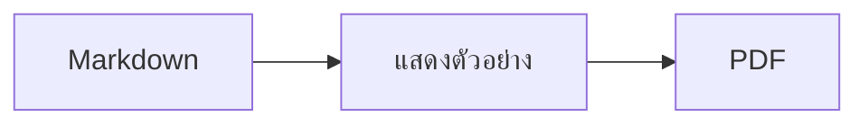
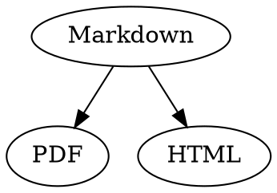

# คู่มืออ้างอิงด่วน Markdown

ภาพรวมนี้เป็นเอกสารธรรมดา คุณจึงลองเขียนในเอกสารนี้ได้เลย ทั้งในข้อความต้นฉบับทางซ้ายหรือในส่วนแสดงตัวอย่างทางขวา

## ข้อความ

| ผลลัพธ์ | วิธีเขียน | ปุ่มลัด |
|---|---|---|
| **ตัวหนา** | `**ตัวหนา**` | ⌘B |
| *ตัวเอียง* | `*ตัวเอียง*` | ⌘I |
| <ins>ขีดเส้นใต้</ins> | `<ins>ขีดเส้นใต้</ins>` | ⌘U |
| ~~ขีดทับ~~ | `~~ขีดทับ~~` | ⇧⌘X |
| <mark>ไฮไลท์</mark> | `<mark>ไฮไลท์</mark>` | |
| `โค้ด` | `` `โค้ด` `` | |
| x<sup>2</sup> | `x<sup>2</sup>` | |
| H<sub>2</sub>O | `H<sub>2</sub>O` | |
| [ลิงก์](https://example.com) | `[ลิงก์](https://example.com)` | ⌘K |

ขีดเส้นใต้ ไฮไลท์ ตัวยก และตัวห้อยไม่ใช่ Markdown มาตรฐาน แต่เป็น HTML โปรแกรมดู Markdown บางตัวจึงอาจไม่แสดงผล

เมื่อเคอร์เซอร์อยู่ท้ายคำ การจัดรูปแบบจะมีผลกับสิ่งที่คุณพิมพ์ต่อจากนั้น แต่ถ้าเคอร์เซอร์อยู่กลางคำ ทั้งคำจะถูกจัดรูปแบบ

## หัวข้อ

```
# หัวข้อ 1
## หัวข้อ 2
### หัวข้อ 3
```

ปุ่มลัด: ⌥⌘1 ถึง ⌥⌘6 และเนื้อความใช้ ⌥⌘0

## รายการ

- รายการแบบจุดใช้ `-`
- ข้อที่สอง
  - เยื้องด้วยปุ่ม Tab ในส่วนแสดงตัวอย่าง

1. รายการแบบตัวเลขใช้ `1.`
2. ข้อที่สอง

- [ ] งานที่ยังไม่เสร็จ
- [x] งานที่เสร็จแล้ว (คลิกในส่วนแสดงตัวอย่างเพื่อสลับสถานะ)

## คำอ้างอิงและโค้ด

> คำอ้างอิงขึ้นต้นด้วย `>`

```rust
fn main() {
    println!("บล็อกโค้ดที่ระบุภาษา");
}
```

ชื่อภาษาที่เขียนต่อจากแบ็กทิกสามตัวจะทำให้โค้ดแสดงสีตามไวยากรณ์ “รูปแบบ › บล็อกโค้ด” มีภาษาที่ใช้กันทั่วไปให้เลือก และเปลี่ยนภาษาของบล็อกที่มีอยู่แล้วได้ด้วย

> [!TIP]
> กล่องหมายเหตุมีแบบหมายเหตุ เคล็ดลับ สำคัญ คำเตือน และข้อควรระวัง (“รูปแบบ › กล่องหมายเหตุ” จะจัดรูปแบบย่อหน้าที่เคอร์เซอร์อยู่)

## ตาราง

| ชิดซ้าย | กึ่งกลาง | ชิดขวา |
|:------|:---------:|-------:|
| a     | b         | c      |

ในส่วนแสดงตัวอย่าง ปุ่ม Tab จะย้ายไปยังเซลล์ถัดไป และปุ่ม Return จะย้ายไปยังเซลล์ด้านล่าง เมนู “ตาราง” ใช้แทรกแถวและคอลัมน์ และจัดแนวคอลัมน์ในข้อความต้นฉบับให้ตรงกัน

## สูตรและแผนภาพ

สูตรในบรรทัด: $E = mc^2$

$$
\int_0^1 x^2 \, dx = \frac{1}{3}
$$



การคลิกสูตรหรือแผนภาพในส่วนแสดงตัวอย่างจะเปิดตัวแก้ไข เช่นเดียวกับเมื่อเคอร์เซอร์ย้ายไปอยู่บนสูตรหรือแผนภาพนั้น ปุ่ม Esc จะปิดตัวแก้ไขโดยไม่เปลี่ยนแปลงอะไร สูตรแก้ไขได้ทั้งแบบภาพหรือเป็น LaTeX บล็อกสำเร็จรูปใช้แทรกเศษส่วน ราก ผลรวม และสัญลักษณ์ ส่วนปุ่ม Tab จะข้ามไปยังตัวยึดตำแหน่ง □ ถัดไป ผังงาน แผนภาพลำดับ และแผนภูมิแกนต์มีบล็อกสำเร็จรูปสำหรับโหนด เส้นเชื่อม ข้อความ และงาน ตัวแก้ไขจะแสดงข้อผิดพลาดในโค้ดทันที

สูตรยังเขียนไว้ในบล็อก `math` หรือระหว่าง `\(` และ `\)` ได้ด้วย ส่วนแผนภาพ Graphviz และ PlantUML เขียนไว้ในบล็อกที่ระบุ `dot` และ `plantuml`:



```plantuml
Alice -> Bob : Hi
```

## รูปแบบการเขียนเพิ่มเติม

==ไฮไลท์== x^2^ H~2~O ||สปอยล์|| และ :rocket: มาจาก Obsidian, Typora และ GitHub %%ความคิดเห็น%% จะอยู่ในข้อความต้นฉบับเท่านั้น และเชิงอรรถเขียนไว้ในเนื้อความได้โดยตรง^[แบบนี้]

คำศัพท์

: คำอธิบายในรายการคำนิยาม

> [!tip]-
> คลิก ▸ เพื่อขยายกล่อง

[[โน้ต]] จะลิงก์ไปยังโน้ตในโฟลเดอร์เดียวกันหรือโฟลเดอร์ย่อย ส่วน ![[โน้ต]] จะฝังโน้ตนั้นไว้ แท็กอย่าง #ไอเดีย การอ้างอิงอย่าง @name และ #12 ในโปรเจกต์ GitHub และ GitLab และการอ้างอิงแหล่งที่มาอย่าง [@doe2020] จากไฟล์ BibTeX จะถูกไฮไลท์ และ ⌘-คลิกเพื่อไปยังสิ่งที่อ้างอิงได้ “มุมมอง › เครื่องหมายวรรคตอนแบบงานพิมพ์” จะใช้อัญประกาศ ขีด และจุดไข่ปลาตามแบบของภาษานั้น

### จุดยึดที่กำหนดเอง {#anchor}

<details>
<summary>HTML</summary>

HTML แบบเดียวกับใน README ของ GitHub จะแสดงผลได้ เช่น ย่อหน้าที่จัดกึ่งกลาง ภาพที่กำหนดขนาด <kbd>⌘</kbd> และส่วนที่ยุบหรือขยายได้อย่างส่วนนี้

</details>

## อื่นๆ

การกดปุ่ม Return บนบรรทัดว่างในส่วนแสดงตัวอย่างจะแทรกบรรทัดว่างเพิ่มอีกหนึ่งบรรทัด และปุ่ม Delete จะลบบรรทัดนั้นออก ในข้อความต้นฉบับจะมีบรรทัดว่างเพิ่มขึ้นสองบรรทัดสำหรับสิ่งนี้ ส่วนโปรแกรม Markdown อื่นจะแสดงเป็นระยะห่างระหว่างย่อหน้าตามปกติ

“แทรก › ตารางสารบัญ” จะลิงก์หัวข้อทั้งหมด และถ้าเคอร์เซอร์อยู่ในตารางสารบัญ ตารางสารบัญจะได้รับการอัปเดต ⌘-คลิกที่รายการเพื่อข้ามไปยังหัวข้อนั้น

เชิงอรรถใช้อ้างถึงคำอธิบายเพิ่มเติม[^1] ส่วนเส้นคั่นสร้างได้ด้วย `---`:

---

[^1]: คำอธิบายเพิ่มเติมอยู่ที่ท้ายเอกสาร
