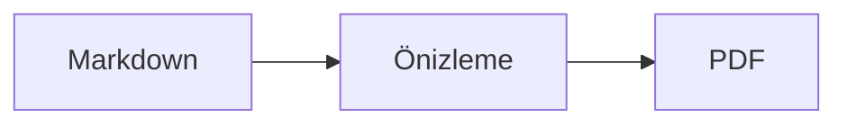
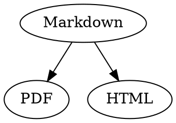

# Markdown Hızlı Başvuru

Bu genel bakış sıradan bir belgedir: İçinde soldaki kaynakta veya sağdaki önizlemede deneme yapabilirsiniz.

## Metin

| Sonuç | Yazım | Kısayol |
|---|---|---|
| **Kalın** | `**Kalın**` | ⌘B |
| *İtalik* | `*İtalik*` | ⌘I |
| <ins>Altı çizili</ins> | `<ins>Altı çizili</ins>` | ⌘U |
| ~~Üstü çizili~~ | `~~Üstü çizili~~` | ⇧⌘X |
| <mark>Vurgu</mark> | `<mark>Vurgu</mark>` | |
| `Kod` | `` `Kod` `` | |
| x<sup>2</sup> | `x<sup>2</sup>` | |
| H<sub>2</sub>O | `H<sub>2</sub>O` | |
| [Bağlantı](https://example.com) | `[Bağlantı](https://example.com)` | ⌘K |

Altı çizili ve vurgulu metin, üs ve indis standart Markdown değil, HTML'dir. Her Markdown görüntüleyicisi bunları göstermez.

İmleç bir sözcüğün sonundaysa biçimlendirme bundan sonra yazdıklarınıza uygulanır; sözcüğün içindeyse tüm sözcüğü biçimlendirir.

## Başlıklar

```
# Başlık 1
## Başlık 2
### Başlık 3
```

Kısayollar: ⌥⌘1 ile ⌥⌘6 arası, gövde metni için ⌥⌘0.

## Listeler

- `-` ile madde işaretli liste
- İkinci öğe
  - Önizlemede Tab ile girintili

1. `1.` ile numaralı liste
2. İkinci öğe

- [ ] Açık görev
- [x] Tamamlanan görev (değiştirmek için önizlemede tıklayın)

## Alıntılar ve kod

> Alıntı `>` ile başlar.

```rust
fn main() {
    println!("Dil belirtilmiş kod bloku");
}
```

Üç ters tırnaktan sonra yazılan dil, sözdizimi renklendirmesi sağlar. “Biçim › Kod Bloku” yaygın dilleri sunar ve mevcut bir bloğun dilini de değiştirir.

> [!TIP]
> Bilgi kutuları Not, İpucu, Önemli, Uyarı ve Dikkat türlerinde bulunur (“Biçim › Bilgi Kutusu” imlecin bulunduğu paragrafı biçimlendirir).

## Tablolar

| Sol | Orta | Sağ |
|:------|:---------:|-------:|
| a     | b         | c      |

Önizlemede Tab bir sonraki hücreye, Return alttaki hücreye geçer. “Tablo” menüsü satır ve sütun ekler ve kaynaktaki sütunları hizalar.

## Formüller ve diyagramlar

Satır içi formül: $E = mc^2$

$$
\int_0^1 x^2 \, dx = \frac{1}{3}
$$



Önizlemede bir formüle veya diyagrama tıklamak düzenleyiciyi açar; imleç üzerine geldiğinde de açılır. Esc düzenleyiciyi değişiklik yapmadan kapatır. Formüller görsel olarak veya LaTeX olarak düzenlenebilir; yapı taşları kesir, kök, toplam ve simge ekler, Tab bir sonraki □ yer tutucusuna atlar. Akış şemaları, sıralama diyagramları ve Gantt şemaları için düğüm, bağlantı, ileti ve görev yapı taşları vardır. Düzenleyici koddaki hataları hemen gösterir.

Formüller `math` bloklarında ya da `\(` ile `\)` arasında da yazılabilir. Graphviz ve PlantUML diyagramları `dot` ve `plantuml` bloklarına yazılır:



```plantuml
Alice -> Bob : Hi
```

## Genişletilmiş söz dizimi

==Vurgu==, x^2^, H~2~O, ||spoiler|| ve :rocket: Obsidian, Typora ve GitHub’dan gelir. %%Yorumlar%% yalnızca kaynakta kalır, dipnotlar da doğrudan metnin içinde olabilir^[bunun gibi].

Terim

: Tanım listesinde açıklama

> [!tip]-
> Kutuyu genişletmek için ▸ simgesine tıklayın.

[[Not]] aynı klasördeki ya da altındaki bir nota bağlantı verir, ![[Not]] onu gömer. #Etiketler, GitHub ve GitLab projelerinde @ad ve #12 gibi başvurular ve bir BibTeX dosyasından [@doe2020] gibi alıntılar vurgulanır; ⌘-tıklama onları izler. “Görüntü › Tipografik noktalama” dilin tırnak işaretlerini, tirelerini ve üç noktasını kullanır.

### Özel çapa {#capa}

<details>
<summary>HTML</summary>

GitHub README dosyalarındaki gibi HTML gösterilir: ortalanmış paragraflar, boyutlu görseller, <kbd>⌘</kbd> ve bunun gibi açılır bölümler.

</details>

## Diğer

Önizlemedeki boş bir satırda Return bir boş satır daha ekler, Backspace onu kaldırır. Kaynakta bunun için iki ek boş satır bulunur; diğer Markdown programları bunları normal paragraf aralığı olarak gösterir.

“Ekle › İçindekiler” tüm başlıklara bağlantı verir; imleç içindekiler bölümündeyken bu bölüm güncellenir. Bir girişe ⌘-tıklamak başlığa atlar.

Dipnotlar açıklamalara başvurur[^1]. Bölücü çizgi `---` ile oluşturulur:

---

[^1]: Açıklama belgenin sonunda yer alır.
