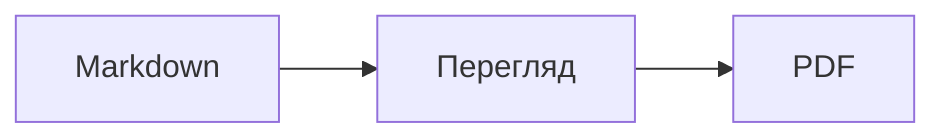
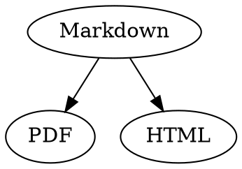

# Короткий довідник Markdown

Цей огляд — звичайний документ: у ньому можна все випробувати, ліворуч у вихідному тексті або праворуч у попередньому перегляді.

## Текст

| Результат | Запис | Скорочення |
|---|---|---|
| **Жирний** | `**Жирний**` | ⌘B |
| *Курсив* | `*Курсив*` | ⌘I |
| <ins>Підкреслення</ins> | `<ins>Підкреслення</ins>` | ⌘U |
| ~~Закреслення~~ | `~~Закреслення~~` | ⇧⌘X |
| <mark>Виділення</mark> | `<mark>Виділення</mark>` | |
| `Код` | `` `Код` `` | |
| x<sup>2</sup> | `x<sup>2</sup>` | |
| H<sub>2</sub>O | `H<sub>2</sub>O` | |
| [Посилання](https://example.com) | `[Посилання](https://example.com)` | ⌘K |

Підкреслення, виділення, надрядковий і підрядковий текст — це не стандартний Markdown, а HTML. Не кожен переглядач Markdown їх показує.

Якщо курсор стоїть у кінці слова, форматування застосовується до того, що ви введете далі; усередині слова воно форматує все слово.

## Заголовки

```
# Заголовок 1
## Заголовок 2
### Заголовок 3
```

Скорочення: від ⌥⌘1 до ⌥⌘6, основний текст — ⌥⌘0.

## Списки

- Список із маркерами через `-`
- Другий пункт
  - Відступ клавішею Tab у попередньому перегляді

1. Нумерований список через `1.`
2. Другий пункт

- [ ] Відкрите завдання
- [x] Виконане завдання (клацніть його в попередньому перегляді, щоб перемкнути)

## Цитати й код

> Цитата починається з `>`.

```rust
fn main() {
    println!("Блок коду з мовою");
}
```

Мова після трьох зворотних апострофів вмикає підсвічування синтаксису. «Формат › Блок коду» пропонує поширені мови й також змінює мову наявного блоку.

> [!TIP]
> Інформаційні блоки бувають пʼяти типів: Примітка, Порада, Важливо, Застереження й Обережно («Формат › Інформаційний блок» форматує абзац, у якому стоїть курсор).

## Таблиці

| Ліворуч | По центру | Праворуч |
|:------|:---------:|-------:|
| a     | b         | c      |

У попередньому перегляді Tab переходить до наступної клітинки, а Return — до клітинки нижче. Меню «Таблиця» вставляє рядки й стовпці та вирівнює стовпці у вихідному тексті.

## Формули й діаграми

Формула в тексті: $E = mc^2$

$$
\int_0^1 x^2 \, dx = \frac{1}{3}
$$



Клацання формули чи діаграми в попередньому перегляді відкриває редактор, так само як і переміщення курсора на неї; Esc закриває його без змін. Формули можна редагувати візуально або як LaTeX; готові елементи вставляють дроби, корені, суми й символи, а Tab переходить до наступного заповнювача □. Для блок-схем, діаграм послідовності й діаграм Ганта є готові елементи для вузлів, зʼєднань, повідомлень і завдань. Помилки в коді редактор показує одразу.

Формули також можна писати в блоках `math` або між `\(` і `\)`. Діаграми Graphviz і PlantUML розміщують у блоках `dot` і `plantuml`:



```plantuml
Alice -> Bob : Hi
```

## Розширений синтаксис

==Виділення==, x^2^, H~2~O, ||спойлер|| і :rocket: походять з Obsidian, Typora та GitHub. %%Коментарі%% лишаються тільки у вихідному тексті, а виноски можна писати й просто в тексті^[як ця].

Термін

: Пояснення в списку визначень

> [!tip]-
> Клацніть ▸, щоб розгорнути блок.

[[Нотатка]] посилається на нотатку в тій самій папці або глибше, ![[Нотатка]] вбудовує її. #Теги, посилання на кшталт @name і #12 у проєктах GitHub і GitLab, а також цитування на кшталт [@doe2020] з файлу BibTeX виділяються; ⌘-клацання переходить до них. «Перегляд › Типографські розділові знаки» ставить лапки, тире й три крапки, прийняті в мові інтерфейсу.

### Власний якір {#anchor}

<details>
<summary>HTML</summary>

HTML, як у файлах README на GitHub, відображається: вирівняні по центру абзаци, зображення із заданим розміром, <kbd>⌘</kbd> і розгортані розділи, як цей.

</details>

## Інше

Return у порожньому рядку попереднього перегляду вставляє ще один порожній рядок, а Delete вилучає його. У вихідному тексті для цього стоять два додаткові порожні рядки; інші програми для Markdown показують їх як звичайний відступ між абзацами.

«Вставити › Зміст» створює посилання на всі заголовки; якщо курсор стоїть у змісті, зміст оновлюється. ⌘-клацання пункту переходить до заголовка.

Виноски посилаються на примітки[^1]. Горизонтальну лінію створюють за допомогою `---`:

---

[^1]: Примітка розташована в кінці документа.
