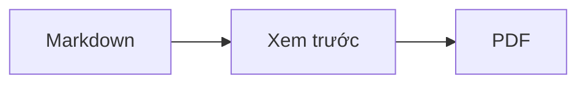
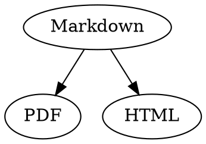

# Tham khảo nhanh Markdown

Bản tổng quan này là một tài liệu bình thường: bạn có thể thử ngay trong đó, ở mã nguồn bên trái hoặc ở bản xem trước bên phải.

## Văn bản

| Kết quả | Cú pháp | Phím tắt |
|---|---|---|
| **Đậm** | `**Đậm**` | ⌘B |
| *Nghiêng* | `*Nghiêng*` | ⌘I |
| <ins>Gạch chân</ins> | `<ins>Gạch chân</ins>` | ⌘U |
| ~~Gạch xuyên~~ | `~~Gạch xuyên~~` | ⇧⌘X |
| <mark>Tô sáng</mark> | `<mark>Tô sáng</mark>` | |
| `Mã` | `` `Mã` `` | |
| x<sup>2</sup> | `x<sup>2</sup>` | |
| H<sub>2</sub>O | `H<sub>2</sub>O` | |
| [Liên kết](https://example.com) | `[Liên kết](https://example.com)` | ⌘K |

Gạch chân, tô sáng, chỉ số trên và chỉ số dưới không phải là Markdown chuẩn mà là HTML. Không phải trình xem Markdown nào cũng hiển thị chúng.

Khi con trỏ ở cuối một từ, định dạng áp dụng cho những gì bạn gõ tiếp theo; ở giữa từ, định dạng áp dụng cho cả từ.

## Đề mục

```
# Đề mục 1
## Đề mục 2
### Đề mục 3
```

Phím tắt: ⌥⌘1 đến ⌥⌘6, văn bản thường với ⌥⌘0.

## Danh sách

- Danh sách dấu đầu dòng với `-`
- Mục thứ hai
  - Thụt lề bằng Tab trong bản xem trước

1. Danh sách đánh số với `1.`
2. Mục thứ hai

- [ ] Công việc chưa xong
- [x] Công việc đã xong (bấm vào trong bản xem trước để chuyển trạng thái)

## Trích dẫn và mã

> Trích dẫn bắt đầu bằng `>`.

```rust
fn main() {
    println!("Khối mã có ngôn ngữ");
}
```

Tên ngôn ngữ sau ba dấu backtick sẽ tô màu cú pháp. “Định dạng › Khối mã” liệt kê các ngôn ngữ phổ biến và cũng đổi ngôn ngữ cho một khối có sẵn.

> [!TIP]
> Hộp chú thích có các loại Ghi chú, Mẹo, Quan trọng, Cảnh báo và Thận trọng (“Định dạng › Hộp chú thích” định dạng đoạn văn tại con trỏ).

## Bảng

| Trái | Giữa | Phải |
|:------|:---------:|-------:|
| a     | b         | c      |

Trong bản xem trước, Tab chuyển sang ô tiếp theo, Return chuyển xuống ô bên dưới. Menu “Bảng” chèn hàng và cột, đồng thời căn thẳng các cột trong mã nguồn.

## Công thức và sơ đồ

Công thức trong dòng: $E = mc^2$

$$
\int_0^1 x^2 \, dx = \frac{1}{3}
$$



Bấm vào một công thức hoặc sơ đồ trong bản xem trước sẽ mở trình soạn thảo, tương tự khi con trỏ di chuyển tới đó; Esc đóng trình soạn thảo mà không thay đổi gì. Công thức có thể được sửa trực quan hoặc dưới dạng LaTeX; các khối dựng chèn phân số, căn, tổng và ký hiệu, Tab chuyển đến chỗ trống □ tiếp theo. Lưu đồ, sơ đồ tuần tự và biểu đồ Gantt có khối dựng cho nút, kết nối, tin nhắn và công việc. Trình soạn thảo hiển thị lỗi trong mã ngay lập tức.

Công thức cũng có thể nằm trong khối `math` hoặc giữa `\(` và `\)`. Sơ đồ Graphviz và PlantUML nằm trong khối `dot` và `plantuml`:



```plantuml
Alice -> Bob : Hi
```

## Cú pháp mở rộng

==Tô sáng==, x^2^, H~2~O, ||spoiler|| và :rocket: đến từ Obsidian, Typora và GitHub. %%Chú thích%% chỉ nằm trong mã nguồn, còn chú thích cuối trang cũng có thể nằm ngay trong văn bản^[như thế này].

Thuật ngữ

: Giải thích trong danh sách định nghĩa

> [!tip]-
> Nhấp vào ▸ để mở rộng hộp.

[[Ghi chú]] liên kết tới ghi chú trong cùng thư mục hoặc bên dưới, ![[Ghi chú]] nhúng ghi chú đó. #Thẻ, tham chiếu như @tên và #12 trong dự án GitHub và GitLab và trích dẫn như [@doe2020] từ tệp BibTeX được tô sáng; ⌘-nhấp để đi theo chúng. “Xem › Dấu câu kiểu chữ in” dùng dấu ngoặc kép, gạch nối và dấu ba chấm của ngôn ngữ.

### Neo riêng {#neo}

<details>
<summary>HTML</summary>

HTML như trong README của GitHub được hiển thị: đoạn văn căn giữa, hình ảnh có kích thước, <kbd>⌘</kbd> và các phần thu gọn như phần này.

</details>

## Khác

Return trên một dòng trống của bản xem trước sẽ chèn thêm một dòng trống, Backspace xóa dòng đó. Trong mã nguồn, mỗi dòng như vậy là hai dòng trống bổ sung; các chương trình Markdown khác hiển thị chúng như khoảng cách đoạn văn bình thường.

“Chèn › Mục lục” tạo liên kết tới tất cả đề mục; khi con trỏ nằm trong mục lục, mục lục sẽ được cập nhật. ⌘-bấm vào một mục để chuyển tới đề mục đó.

Chú thích cuối trang trỏ tới phần ghi chú[^1]. Đường phân cách được tạo bằng `---`:

---

[^1]: Phần ghi chú nằm ở cuối tài liệu.
