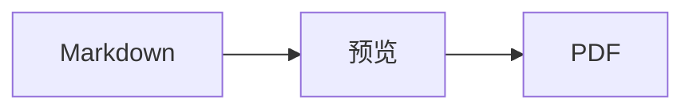
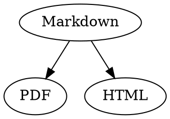

# Markdown 快速参考

这份概览是一个普通文稿：你可以在其中试用各种写法，在左侧的源文本或右侧的预览中均可。

## 文本

| 效果 | 写法 | 快捷键 |
|---|---|---|
| **粗体** | `**粗体**` | ⌘B |
| *斜体* | `*斜体*` | ⌘I |
| <ins>下划线</ins> | `<ins>下划线</ins>` | ⌘U |
| ~~删除线~~ | `~~删除线~~` | ⇧⌘X |
| <mark>高亮</mark> | `<mark>高亮</mark>` | |
| `代码` | `` `代码` `` | |
| x<sup>2</sup> | `x<sup>2</sup>` | |
| H<sub>2</sub>O | `H<sub>2</sub>O` | |
| [链接](https://example.com) | `[链接](https://example.com)` | ⌘K |

下划线、高亮、上标和下标并非 Markdown 标准语法，而是 HTML。并非所有 Markdown 查看器都能显示它们。

光标位于词尾时，格式会应用到你接下来输入的内容；光标位于词中时，则会格式化整个词。

## 标题

```
# 标题 1
## 标题 2
### 标题 3
```

快捷键：⌥⌘1 至 ⌥⌘6，正文用 ⌥⌘0。

## 列表

- 用 `-` 创建项目符号列表
- 第二项
  - 在预览中按 Tab 键缩进

1. 用 `1.` 创建编号列表
2. 第二项

- [ ] 未完成的任务
- [x] 已完成的任务（在预览中点按即可切换）

## 引用和代码

> 引用以 `>` 开头。

```rust
fn main() {
    println!("带语言的代码块");
}
```

三个反引号后面的语言名称会启用语法着色。“格式 › 代码块”提供常用语言，也可以更改现有代码块的语言。

> [!TIP]
> 标注分为备注、提示、重要、警告和注意（“格式 › 标注”会格式化光标所在的段落）。

## 表格

| 左对齐 | 居中 | 右对齐 |
|:------|:---------:|-------:|
| a     | b         | c      |

在预览中，按 Tab 键跳到下一个单元格，按 Return 键跳到下方的单元格。“表格”菜单可插入行和列，并在源文本中对齐各列。

## 公式和图表

行内公式：$E = mc^2$

$$
\int_0^1 x^2 \, dx = \frac{1}{3}
$$



在预览中点按公式或图表即可打开编辑器，光标移到其上时也会打开；按 Esc 键可关闭编辑器且不做任何更改。公式可以可视化编辑，也可以用 LaTeX 编辑；构建块可插入分数、根式、求和与符号，按 Tab 键跳到下一个占位符 □。流程图、时序图和甘特图提供用于节点、连线、消息和任务的构建块。编辑器会直接显示代码中的错误。

公式也可以写在 `math` 代码块中，或写在 `\(` 和 `\)` 之间。Graphviz 和 PlantUML 图表写在标记为 `dot` 和 `plantuml` 的代码块中：



```plantuml
Alice -> Bob : Hi
```

## 扩展语法

==高亮==、x^2^、H~2~O、||剧透|| 和 :rocket: 来自 Obsidian、Typora 和 GitHub。%%注释%% 只保留在源文本中，脚注也可以直接写在正文中^[就像这条]。

术语

: 定义列表中的解释

> [!tip]-
> 点按 ▸ 即可展开此框。

[[笔记]] 链接到同一文件夹或其子文件夹中的笔记，![[笔记]] 则将其嵌入。像 #标签 这样的标签、GitHub 和 GitLab 项目中像 @name 和 #12 这样的引用，以及来自 BibTeX 文件、像 [@doe2020] 这样的文献引用都会高亮显示；按住 ⌘ 点按即可前往。“显示 › 排版标点”会使用该语言的引号、破折号和省略号。

### 自定义锚点 {#anchor}

<details>
<summary>HTML</summary>

像 GitHub README 中那样的 HTML 也会被渲染：居中的段落、指定大小的图像、<kbd>⌘</kbd> 以及像这样的可折叠部分。

</details>

## 其他

在预览的空行上按 Return 键会再插入一个空行，按删除键则将其移除。源文本中会为此多出两个空行；其他 Markdown 程序会将其显示为普通的段落间距。

“插入 › 目录”会链接所有标题；光标位于目录中时，目录会随之更新。按住 ⌘ 点按条目即可跳到对应的标题。

脚注指向注释[^1]。用 `---` 可创建分隔线：

---

[^1]: 注释位于文稿末尾。
