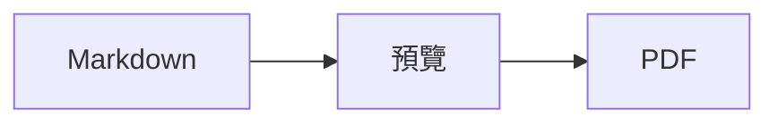
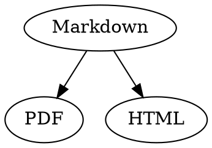

# Markdown 快速參考

這份總覽是一般的文件：你可以直接在裡面試用，左邊是原始碼，右邊是預覽。

## 文字

| 結果 | 寫法 | 快速鍵 |
|---|---|---|
| **粗體** | `**粗體**` | ⌘B |
| *斜體* | `*斜體*` | ⌘I |
| <ins>底線</ins> | `<ins>底線</ins>` | ⌘U |
| ~~刪除線~~ | `~~刪除線~~` | ⇧⌘X |
| <mark>醒目標示</mark> | `<mark>醒目標示</mark>` | |
| `程式碼` | `` `程式碼` `` | |
| x<sup>2</sup> | `x<sup>2</sup>` | |
| H<sub>2</sub>O | `H<sub>2</sub>O` | |
| [連結](https://example.com) | `[連結](https://example.com)` | ⌘K |

底線、醒目標示、上標和下標不是標準的 Markdown，而是 HTML。並非每個 Markdown 檢視器都能顯示它們。

游標位於字詞結尾時，格式會套用到接下來輸入的內容；位於字詞中間時，則會套用到整個字詞。

## 標題

```
# 標題 1
## 標題 2
### 標題 3
```

快速鍵：⌥⌘1 至 ⌥⌘6，內文為 ⌥⌘0。

## 列表

- 以 `-` 建立項目符號列表
- 第二項
  - 在預覽中按 Tab 鍵縮排

1. 以 `1.` 建立編號列表
2. 第二項

- [ ] 未完成的待辦事項
- [x] 已完成的待辦事項（在預覽中按一下即可切換）

## 引言與程式碼

> 引言以 `>` 開頭。

```rust
fn main() {
    println!("指定語言的程式碼區塊");
}
```

三個反引號後面的語言會啟用語法上色。「格式 › 程式碼區塊」提供常用的語言，也能變更現有區塊的語言。

> [!TIP]
> 標註框分為附註、提示、重要、警告和小心（「格式 › 標註框」會格式化游標所在的段落）。

## 表格

| 靠左 | 置中 | 靠右 |
|:------|:---------:|-------:|
| a     | b         | c      |

在預覽中，按 Tab 鍵會跳到下一個儲存格，按 Return 鍵會跳到下方的儲存格。「表格」選單可插入列與欄，並在原始碼中對齊各欄。

## 公式與圖表

行內公式：$E = mc^2$

$$
\int_0^1 x^2 \, dx = \frac{1}{3}
$$



在預覽中按一下公式或圖表即可打開編輯器，游標移到上面時也會打開；按 Esc 鍵會關閉編輯器，且不做任何更改。公式可以用視覺化方式或 LaTeX 編輯；組件可插入分數、根號、總和與符號，按 Tab 鍵會跳到下一個佔位符號 □。流程圖、循序圖和甘特圖都有節點、連線、訊息和任務的組件。編輯器會立即顯示程式碼中的錯誤。

公式也可以寫在 `math` 區塊中，或放在 `\(` 和 `\)` 之間。Graphviz 和 PlantUML 圖表則寫在標示為 `dot` 和 `plantuml` 的區塊中：



```plantuml
Alice -> Bob : Hi
```

## 延伸語法

==醒目標示==、x^2^、H~2~O、||劇透|| 和 :rocket: 來自 Obsidian、Typora 和 GitHub。%%註解%% 只會留在原始碼中，註腳也可以直接寫在文字裡^[像這樣]。

術語

: 定義列表中的說明

> [!tip]-
> 按一下 ▸ 即可展開方塊。

[[筆記]] 會連結到同一個檔案夾或其子檔案夾中的筆記，![[筆記]] 則會將它嵌入。像 #標籤、GitHub 和 GitLab 專案中的 @name 與 #12 這類參照，以及 BibTeX 檔案中的 [@doe2020] 這類引用，都會醒目標示；按住 ⌘ 鍵按一下即可前往。「顯示方式 › 排版標點符號」會將引號、破折號和刪節號換成該語言的樣式。

### 自訂錨點 {#anchor}

<details>
<summary>HTML</summary>

與 GitHub README 相同的 HTML 都會呈現：置中的段落、指定大小的影像、<kbd>⌘</kbd>，以及像這樣可展開的區段。

</details>

## 其他

在預覽的空白行上按 Return 鍵會再插入一個空白行，按 Delete 鍵則會移除它。原始碼中會為此保留兩個額外的空白行；其他 Markdown 程式會將它們顯示為一般的段落間距。

「插入 › 目錄」會連結所有標題；游標位於目錄內時，目錄會隨之更新。按住 ⌘ 鍵按一下項目即可跳到該標題。

註腳會指向文件結尾的說明[^1]。以 `---` 建立分隔線：

---

[^1]: 說明位於文件的結尾。
